<div align="center">


<br>

**`> jogo de terminal sobre Arquitetura Computacional`**

[](https://enzofuchsb.github.io/arqcomp-rootaccess/)


</div>

```
root@sys:~$ cat MISSAO.txt
```

> O computador está desligado e o **firewall travou os 16 módulos de hardware**.
> No **Ato 1** você dá a partida no PC ligando as 6 peças mínimas, uma por uma.
> No **Ato 2** o sistema **ROOT/OS 2002** sobe em **modo de segurança**: as outras
> 10 peças estão escondidas em pastas, arquivos e programas. Encontre as pistas e
> religue tudo antes que o rastreamento chegue a **100%**.

---

## `[ OK ]` Ato 1 · Partida (terminal)

```
[  OK  ] Fonte de energia estabilizada
[ LOCK ] Módulo 01 bloqueado — aguardando chave...
root@sys:~$ _
```

1. **Leia o pacote interceptado:** é a pista sobre o componente bloqueado.
2. **Digite o nome do componente.** As casinhas mostram quantas letras ele tem.
3. **Aperte Enter** ou clique em **`> EXECUTAR SCAN`**.
4. As 6 peças vão **em ordem**: `CPU → ROM → RAM → ADDRESSBUS → DATABUS → MEMORIADEMASSA`.
5. Ao ligar a memória de massa: `[ OK ] Sistema operacional encontrado no disco` → tela de carregamento do **ROOT/OS 2002** → desktop.

> Respostas são conferidas em MAIÚSCULAS, sem acento e sem espaço.
> `memória de massa` vira `MEMORIADEMASSA`.
>
> Clique na tela durante a animação de abertura para pular direto para o menu.

<div align="center">

</div>

---

## `[ SYS ]` Ato 2 · Sistema (desktop ROOT/OS 2002)

Um sistema operacional com cara de anos 2000, mas com identidade própria: papel de
parede de trilhas de placa de circuito, barra de tarefas azul, botão **Iniciar**,
relógio, bandeja com o escudo do **ROOT Defender** e o aviso **"Modo de segurança"**
nos quatro cantos. As janelas abrem com duplo clique, arrastam pela barra de título,
minimizam para a barra de tarefas e, no celular, abrem em tela cheia.

**Como funciona**

- **Tutorial:** ao entrar no desktop, um pop-up avisa que há uma mensagem nova. O e-mail
  do **fuchs** explica o Ato 2 e termina com um exemplo: abrir o e-mail logo abaixo,
  que traz a dica da próxima palavra.
- Explore os programas. Ao abrir o lugar certo pela primeira vez, a pista é
  **coletada**: bipe + balão `Pacote interceptado: PKT#NN`.
- Abra o **Terminal (root.exe)**. À esquerda fica a lista **PACOTES COLETADOS**
  (número, onde foi achado e a pista). O que falta aparece como `PKT#?? — não encontrado`.
- Digite **qualquer resposta, em qualquer ordem**. Se bater com um módulo pendente,
  ele fica **ONLINE**. Dá até para acertar antes de achar a pista.
- **BRUTE FORCE** e **SNIFF** agem sobre o **pacote selecionado** (clique nele na lista).

**Enigmas** (valores sorteados a cada partida)

| Onde | Enigma |
|:--|:--|
| **Painel de Controle › Sistema** | Ordenar os cartões BUSCAR, DECODIFICAR, EXECUTAR, ARMAZENAR (arrastar ou ← →) e Aplicar. Errou: **+3%**. |
| **notas_do_admin.txt + Painel de Controle › BIOS** | As notas têm um mini programa (MOV, ADD, SUB, MUL). O valor final de A é o PIN da BIOS. PIN errado: **+5%**. |
| **Internet** | Sem a CACHE online, as páginas carregam lentas e cortadas. A página certa está no **Histórico**. Com a CACHE online, tudo carrega normal. |
| **Disco removível (E:)** | `leia_me.txt` está em 4 blocos fora de ordem: ordenar pelo número do setor (arrastar ou ↑ ↓) e Montar arquivo. |
| **Gerenciador de Tarefas** | Só abre com a UC online. Em Desempenho, mover processos entre os núcleos até nenhum passar de 100%. |

**Camadas extras**

| Onde | O que acontece |
|:--|:--|
| **Lixeira › relatorio_perifericos.txt** | Texto cifrado com **Cifra de César**. Gire a chave no **DECODIFICADOR** (− / +) ou use `decrypt --chave N` no Terminal. A pista só conta quando o texto fica legível. |
| **Documentos › Confidencial** | Pasta com senha. Senha errada: **+5%** e "acesso negado". A dica está num e-mail do Admin. Dentro há um `postit.txt` com a chave da Lixeira. |
| **Documentos › NAO_ABRA.exe** | Armadilha (*honeypot*): a tela pisca em vermelho, o alarme toca, o Defender acusa **AMEAÇA DETECTADA** e o trace sobe **+15%**. |
| **Novo hardware** | Quando os outros 9 módulos do Ato 2 estão online, aparece um dispositivo USB desconhecido no Gerenciador de Dispositivos. |

---

## `[ SCAN ]` ROOT Defender

O antivírus do ROOT/OS fica na bandeja mostrando o mesmo % do trace.

| Evento | Quando | Efeito |
|:--|:--|:--|
| **Varredura** | aleatória, a cada 60–120 s | pop-up com barra de progresso; por 10 s o trace passivo sobe **2x mais rápido** |
| **Verificação de integridade** | aleatória, a cada 70–110 s, nunca junto da varredura | mostra a pista de um módulo **já ONLINE**; acertou o nome = **−2%** de trace. Errar ou ignorar não custa nada; fecha sozinha em 20 s |

---

## `[ WARN ]` O TRACE

<div align="center">

</div>

| Evento | Trace |
|:--|:--:|
| Tempo passando no Ato 1 | `+1%` a cada 6 s |
| Tempo passando no Ato 2 | `+1%` a cada 10 s (2x durante a varredura) |
| Chave errada | `+10%` |
| BRUTE FORCE | `+10%` |
| SNIFF | `+5%` |
| Senha errada na pasta Confidencial | `+5%` |
| Ordem errada no ciclo de instrução (UC) | `+3%` |
| PIN errado na BIOS | `+5%` |
| Abrir NAO_ABRA.exe | `+15%` |
| Verificação de integridade correta | `−2%` |

- **verde**: abaixo de 40% · **âmbar**: 40% a 79% · **vermelho**: 80% ou mais, com alarme
- **100% = `CONEXÃO RASTREADA`** (game over, nos dois atos)

---

## `[ HINT ]` Dicas

| Ferramenta | Custo | O que faz |
|:--|:--:|:--|
| **`BRUTE FORCE`** | `+10%` | Revela uma letra aleatória da resposta (em âmbar). Nunca revela a última que falta. |
| **`SNIFF`** | `+5%` | Mostra uma dica extra sobre a palavra. Só uma vez por palavra. |

---

## `[ SHELL ]` Comandos do terminal

| Comando | Ação |
|:--|:--|
| `help` | lista os comandos |
| `status` | módulos online, trace, erros, dicas e tempo |
| `brute` | mesmo que o botão BRUTE FORCE |
| `sniff` | mesmo que o botão SNIFF |
| `decrypt --chave N` | aplica a chave N no arquivo cifrado da Lixeira (com ele aberto) |
| `clear` | limpa o log |
| `reboot` | reinicia o jogo |

Qualquer outra coisa digitada é tratada como uma tentativa de chave.

---

## `[ DATA ]` Os 16 módulos

<details>
<summary><b>SPOILER: clique para ver as respostas e onde estão as pistas</b></summary>

<br>

| # | Ato | Resposta | Pista principal | Onde está (Ato 2) |
|:-:|:--|:--|:--|:--|
| 01 | 1 · Partida | `CPU` | Chip principal que executa as instruções de todos os programas. | terminal do boot |
| 02 | 1 · Partida | `ROM` | Memória só de leitura que guarda o programa de inicialização de fábrica. | terminal do boot |
| 03 | 1 · Partida | `RAM` | Memória principal de trabalho, volátil: perde tudo quando o computador desliga. | terminal do boot |
| 04 | 1 · Partida | `ADDRESSBUS` | Vias que indicam qual posição da memória o processador quer acessar. | terminal do boot |
| 05 | 1 · Partida | `DATABUS` | Vias por onde as informações viajam entre processador, memória e periféricos. | terminal do boot |
| 06 | 1 · Partida | `MEMORIADEMASSA` | Onde arquivos e sistema ficam guardados mesmo desligado, como HDs e SSDs. | terminal do boot |
| 07 | 2 · Sistema | `UC` | Parte da CPU que busca, decodifica instruções e coordena os outros componentes. | Painel de Controle › Sistema — ordenar o ciclo de instrução |
| 08 | 2 · Sistema | `ULA` | Parte da CPU responsável pelos cálculos e pelas comparações lógicas. | Gerenciador de Tarefas › Processos › calc_unit.exe |
| 09 | 2 · Sistema | `REGISTRADORES` | Pequenas memórias dentro do processador, as mais rápidas do computador. | notas_do_admin.txt (texto do admin) |
| 10 | 2 · Sistema | `EEPROM` | Memória não volátil apagável eletricamente, que guarda configurações da BIOS. | Painel de Controle › BIOS — PIN = resultado do programa nas notas do admin |
| 11 | 2 · Sistema | `CACHE` | Memória ultrarrápida entre CPU e RAM que guarda o que é mais usado. | Internet › Histórico › "Por que meu PC está tão lento?" |
| 12 | 2 · Sistema | `FLASH` | Memória não volátil regravável em blocos, usada em pendrives e cartões SD. | Meu Computador › Disco removível (E:) — montar o leia_me.txt fragmentado |
| 13 | 2 · Sistema | `DUALCORE` | Processador com dois núcleos trabalhando ao mesmo tempo. | Gerenciador de Tarefas › Desempenho — balancear a carga entre 2 núcleos (exige UC online) |
| 14 | 2 · Sistema | `QUADCORE` | Processador com quatro núcleos trabalhando ao mesmo tempo. | E-mail › "Upgrade aprovado" |
| 15 | 2 · Sistema | `DMA` | Recurso que deixa periféricos lerem e gravarem na RAM sem ocupar a CPU. | Lixeira › relatorio_perifericos.txt (cifra, chave 7) |
| 16 | 2 · Sistema | `MICROCONTROLADOR` | Chip com processador, memória e entradas/saídas juntos, como o do Arduino. | Painel de Controle › Gerenciador de Dispositivos (depois dos outros 9) |

Senha da pasta Confidencial: `RAM2002`.

</details>

---

## `[ END ]` Final

Com **16/16** módulos online, o aviso de modo de segurança some, o Gerenciador de
Tarefas mostra os **4 núcleos ativos** e aparece o balão **"Sistema otimizado"**.
A tela dá um glitch e vem o **ACESSO ROOT CONCEDIDO**, com tempo, trace final, erros,
dicas e o **Hall dos Invasores** (top 5 por menor tempo).

---

## `[ SYS ]` Tecnologia

```
index.html   estrutura das telas (boot, Ato 1, carregamento, desktop, game over, vitória)
style.css    visual de terminal + estética do ROOT/OS 2002
script.js    núcleo: dados das 16 palavras, Ato 1, trace, dicas, comandos, sons, hall
desktop.js   desktop do ROOT/OS: ícones, menu Iniciar, barra de tarefas, janelas, balões
apps.js      apps do Ato 2: Terminal root.exe, pistas, Lixeira, Confidencial, honeypot
enigmas.js   enigmas do Ato 2: ciclo de instrução, PIN da BIOS, histórico, setores, núcleos
defender.js  ROOT Defender: varredura e verificação de integridade
assets/      SVGs animados deste README
```

- HTML, CSS e JavaScript **puros**: sem frameworks, sem bibliotecas, sem build.
- Ícones e papel de parede desenhados em **SVG/CSS**, originais.
- Sons gerados na hora com a **Web Audio API**, sem nenhum arquivo de áudio.
- **Hall dos Invasores** salvo no `localStorage` do navegador.
- Fontes: [JetBrains Mono](https://fonts.google.com/specimen/JetBrains+Mono) e [VT323](https://fonts.google.com/specimen/VT323).
- Publicado no **GitHub Pages**.

---

<div align="center">

```
root@sys:~# whoami
root
```

**[`> INICIAR INVASÃO`](https://enzofuchsb.github.io/arqcomp-rootaccess/)**

<sub>Projeto acadêmico · Arquitetura Computacional</sub>

</div>
