<div align="center">



<br>

**`> jogo de terminal sobre Arquitetura Computacional`**

[](https://enzofuchsb.github.io/arqcomp-rootaccess/)


</div>

```
invasor@sys:~$ cat MISSAO.txt
```

> Um computador está travado por um **firewall**. Cada um dos seus **16 componentes**
> (processador, memórias, barramentos...) é uma **palavra** que você precisa descobrir
> a partir de uma pista. Dê a partida na máquina, invada o sistema operacional e religue
> tudo antes que o rastreamento chegue a **100%**.
>
> Você é o hacker. O firewall está te vigiando.

---

## `[ BOOT ]` Como o jogo funciona

```
BOOT ─► ATO 1 · PARTIDA ─► ROOT/OS 2002 ─► ATO 2 · SISTEMA ─► ???
         terminal            carregando       desktop
```

| Etapa | O que acontece |
|:--|:--|
| **Boot** | A BIOS avisa que o firewall bloqueou os 16 módulos. Clique em **INICIAR INVASÃO**. |
| **Ato 1 · Partida** | Um terminal travado. Você liga, **em ordem**, as 6 peças mínimas para o PC dar partida. |
| **Ato 2 · Sistema** | O sistema **ROOT/OS 2002** sobe em modo de segurança. As outras 10 peças estão **escondidas** em pastas, arquivos, programas e enigmas. |
| **???** | Dizem que religar o sistema não é o fim. Ninguém que chegou lá voltou para contar. |

> Respostas são conferidas em MAIÚSCULAS, sem acento e sem espaço:
> `placa de vídeo` vira `PLACADEVIDEO`.

<div align="center">

</div>

---

## `[ OK ]` Ato 1 · Partida

```
[  OK  ] Fonte de energia estabilizada
[ LOCK ] Módulo 01 bloqueado pelo firewall — aguardando chave...
invasor@sys:~$ _
```

1. **Leia o pacote interceptado:** é a pista sobre o componente bloqueado.
2. **Digite o nome do componente.** As casinhas mostram quantas letras ele tem.
3. **Aperte Enter** ou clique em **`> EXECUTAR SCAN`**.
4. Acertou? O módulo fica **ONLINE** e o próximo é liberado. Errou? O **TRACE** sobe.
5. Com as 6 peças mínimas online, o sistema operacional carrega...

---

## `[ SYS ]` Ato 2 · Sistema

<div align="center">

</div>

Um sistema operacional com cara de anos 2000 e identidade própria: área de trabalho,
ícones, menu **Iniciar**, janelas que se arrastam e minimizam, barra de tarefas e o aviso
**"Modo de segurança"** nos quatro cantos. No celular, as janelas abrem em tela cheia.

**Como jogar**

- **Comece pelo E-mail.** Há uma mensagem esperando por você que explica o resto.
- **Explore.** As pistas estão nos programas, pastas e arquivos. Algumas estão à vista,
  outras estão escondidas, trancadas ou embaralhadas e precisam de um pouco de raciocínio.
- Quando você encontra uma pista, toca um bipe e aparece o balão **`Pacote interceptado`**.
- Abra o **Terminal (`root.exe`)**: os pacotes encontrados ficam na lista **PACOTES COLETADOS**.
- Digite as respostas **em qualquer ordem**. Dá até para acertar antes de achar a pista.
- Aqui as casinhas ficam **escondidas**: você não sabe quantas letras a palavra tem até pedir uma dica.
- Alguns programas **dependem de outros** módulos para funcionar. Se algo não abre, talvez falte uma peça.
- **Nem tudo é o que parece.** Há arquivos que mentem e arquivos que pedem para não ser abertos.

**Ferramentas que você vai encontrar**

| Ferramenta | Para que serve |
|:--|:--|
| **Terminal `root.exe`** | Onde você responde, usa as dicas e roda comandos. |
| **LogicNão** | Simulador de portas lógicas (AND, OR, NOT, XOR, NAND, NOR) com circuitos prontos: ligue e desligue as entradas até o LED acender. Cada circuito resolvido traz uma recompensa. |
| **ROOT Defender** | O antivírus do sistema, na bandeja. Ele não é seu amigo, mas às vezes ajuda (veja abaixo). |

---

## `[ SCAN ]` ROOT Defender

O escudo na bandeja mostra o mesmo % do trace. De vez em quando, sem aviso, o Defender:

| Evento | O que faz |
|:--|:--|
| **Varredura** | Uma barra de progresso aparece e, enquanto ela roda, o trace sobe **2x mais rápido**. |
| **Verificação de integridade** | Mostra a pista de um módulo que **já está online**. Acertou o nome: o trace **cai 5%**. Errar não custa nada. |
| **Quarentena** | Pacotes esquecidos por muito tempo somem do Terminal. Clique no escudo para recuperá-los, pagando um pouco de trace. |

E com o trace muito alto, o **firewall começa a mexer no seu sistema**...

---

## `[ WARN ]` O TRACE

<div align="center">

</div>

O firewall está te procurando. A barra sobe sozinha e a cada deslize:

| Evento | Trace |
|:--|:--:|
| Tempo passando no Ato 1 | `+1%` a cada 6 s |
| Tempo passando no Ato 2 | `+1%` a cada 10 s |
| Resposta errada (**cada erro custa mais que o anterior**) | `+10%` → `+12%` → `+15%` → `+18%` → `+20%` |
| BRUTE FORCE | `+10%` |
| SNIFF | `+5%` |
| Senhas, códigos e armadilhas erradas | varia |
| **Palavra acertada no Ato 2** | `−5%` (`−8%` se acertou sem usar dicas nela) |
| Verificação de integridade correta | `−5%` |

- **verde**: abaixo de 40% · **âmbar**: 40% a 79% · **vermelho**: 80% ou mais, com alarme
- **100% = `CONEXÃO RASTREADA`** (game over, em qualquer momento do jogo)

---

## `[ HINT ]` Dicas

| Ferramenta | Custo | O que faz |
|:--|:--:|:--|
| **`BRUTE FORCE`** | `+10%` | Revela uma letra aleatória da resposta (em âmbar). Nunca revela a última. **Só 3 usos no jogo inteiro.** |
| **`SNIFF`** | `+5%` | Mostra uma dica extra sobre a palavra. Uma vez por palavra. |

No Ato 2, as dicas agem sobre o **pacote selecionado** no Terminal (clique nele na lista).

---

## `[ SHELL ]` Comandos do terminal

| Comando | Ação |
|:--|:--|
| `help` | lista os comandos |
| `status` | módulos online, trace, erros, dicas, tempo e BRUTE FORCE restantes |
| `brute` / `sniff` | mesmo que os botões de dica |
| `decrypt --chave N` | aplica uma chave num arquivo cifrado aberto |
| `ls` | lista os arquivos do sistema (só existe sistema de arquivos no Ato 2) |
| `ls -a` | lista também os arquivos ocultos |
| `cat <arquivo>` | mostra o conteúdo de um arquivo |
| `clear` | limpa o log |
| `reboot` | reinicia o jogo |

Qualquer outra coisa digitada é tratada como uma tentativa de resposta.

---

## `[ ???? ]` Processo desconhecido

<div align="center">

</div>

```
[ WARN ] 16/16 módulos online
[ ???? ] processo não identificado ainda em execução (PID 0)
```

Não vamos contar o que acontece quando o último módulo volta.
Só leve isto: **estude as 16 peças**, porque você vai precisar de todas elas de uma vez,
e lembre do básico de **JavaScript** que aprendeu.

Tenha o **som ligado**.

---

## `[ ROOT ]` Vitória e Hall dos Invasores

Quem chega ao fim recebe um **título de hacker** de acordo com o desempenho (erros e dicas da partida inteira)
e pode gravar o codinome no **Hall dos Invasores** (top 5 por menor tempo, salvo no seu navegador).

E quando terminar... não tenha pressa de reiniciar.

---

## `[ SYS ]` Tecnologia

```
index.html    estrutura das telas
style.css     visual de terminal + estética do ROOT/OS 2002
script.js     núcleo: palavras, Ato 1, trace, dicas, comandos, sons, hall
desktop.js    desktop do ROOT/OS: ícones, janelas, menu Iniciar, barra de tarefas
apps.js       apps do Ato 2 e o Terminal root.exe
enigmas.js    enigmas do Ato 2 (valores sorteados a cada partida)
circuitos.js  LogicNão: portas lógicas, circuitos descritos como dados
defender.js   ROOT Defender
batalha.js    ????
final.js      ????
assets/       SVGs deste README e a trilha sonora
```

- HTML, CSS e JavaScript **puros**: sem frameworks, sem bibliotecas, sem build.
- Ícones, papel de parede, portas lógicas e personagens desenhados em **SVG/CSS**, originais.
- Efeitos sonoros gerados na hora com a **Web Audio API**; uma única faixa de música em `assets/audio/`.
- Respeita **`prefers-reduced-motion`** e funciona no celular.
- Fontes: [JetBrains Mono](https://fonts.google.com/specimen/JetBrains+Mono) e [VT323](https://fonts.google.com/specimen/VT323).
- Publicado no **GitHub Pages**.

> **Rodando localmente:** use um servidor (`python -m http.server` ou a extensão Live Server do VS Code).
> Abrindo o `index.html` direto, o navegador bloqueia a música.
>
> Desenvolvedor? O guia completo (com **spoilers**) está em [`DEV.md`](DEV.md).

---

<div align="center">

```
invasor@sys:~$ whoami
invasor
```

**[`> INICIAR INVASÃO`](https://enzofuchsb.github.io/arqcomp-rootaccess/)**

<sub>Projeto acadêmico · Arquitetura Computacional</sub>

</div>
